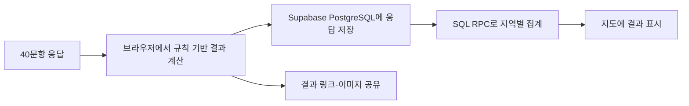

# 정치성향판별기

40문항의 응답을 규칙 기반 성향 결과로 계산하고, 결과 공유와 지역별 통계를 제공하는 웹 서비스입니다.

[서비스 보기](https://www.politicaltests.com)

## 프로젝트 소개

입대 전, 2026년 지방선거를 앞두고 관심이 모이는 주제로 데이터를 수집하고 다루는 연습을 하기 위해 개발했습니다. 특정 정당·후보와 무관한 개인 프로젝트입니다. 결과는 자체 문항과 계산 규칙에 따른 분류이며, 여론조사·선거 예측이나 검증된 심리검사 결과가 아닙니다.

- 누적 응답 약 **19.6만 건**의 운영 경험이 있습니다. 작성자의 운영 기록 기준이며, 순이용자 수와는 다릅니다.
- 생성형 AI 개발 도구와 협업해 기획·구현·배포·운영을 진행했습니다.
- 웹 배포는 GitHub와 연동한 Vercel을 사용합니다.

## 주요 기능

- 40문항 응답과 경제·사회 문항의 점수·방향값에 따른 성향 분류
- 정치 참여·정보 소비 등 보조 결과 표시
- 결과 링크 공유 및 결과 카드 이미지 저장·공유
- 연령대·성별·지역·최종 분류 결과 저장
- SQL RPC를 이용한 지역·결과별 집계와 지도 시각화

## 기술 스택

| 구분 | 기술 |
| --- | --- |
| 웹 | Next.js App Router, React, TypeScript |
| 상태 관리 | Zustand |
| 데이터 저장·집계 | Supabase PostgreSQL, SQL RPC |
| 결과 이미지 | html2canvas |
| 배포 | GitHub 연동 Vercel |

## 서비스 구조



1. `data/questions.ts`의 문항·축·방향값을 사용하고, 응답 상태는 Zustand에서 관리합니다.
2. `app/result/page.tsx`에서 점수를 계산한 뒤 고정 임계값으로 결과를 분류합니다.
3. `responses` 테이블에는 `age`, `gender`, `region`, `result`를 저장합니다. 현재 저장 코드에는 40문항의 개별 답변을 전송하는 처리가 없습니다. 공유 링크로 결과를 보는 경우에는 저장을 건너뜁니다.
4. 지도는 `map_region_stats()` RPC에서 지역·결과별 건수를 조회합니다. 원본 응답을 직접 읽지 않으며, 조회 실패는 오류로 표시합니다. 조회 결과가 비어 있으면 0건으로 표시하고 예시 통계로 대체하지 않습니다. 활성 화면에서는 60초마다 집계를 갱신합니다.

### 핵심 파일

| 파일 | 역할 |
| --- | --- |
| [`data/questions.ts`](data/questions.ts) | 40문항, 평가 축, 문항별 방향값 |
| [`app/test/page.tsx`](app/test/page.tsx) | 문항 응답 화면 |
| [`store/testStore.ts`](store/testStore.ts) | 응답·선택 정보 상태 관리 |
| [`app/result/page.tsx`](app/result/page.tsx) | 규칙 기반 결과 계산, 저장, 공유 |
| [`lib/supabase.ts`](lib/supabase.ts) | 환경 변수로 Supabase 클라이언트 초기화 |
| [`app/map/page.tsx`](app/map/page.tsx) | RPC 조회, 지도 표시, 오류·빈 결과 처리 |
| [`supabase/map_stats.sql`](supabase/map_stats.sql) | 원본 접근 차단, 입력값 검증, 지역별 집계 RPC |
| [`lib/map-stats.ts`](lib/map-stats.ts) | 집계 결과 검증, 지역별 건수·비율 계산 |
| [`supabase/dev_schema.sql`](supabase/dev_schema.sql) | 빈 개발 DB용 테이블 구조 |

## 로컬 실행

### 준비

- Node.js **20.9 이상** 및 npm — 현재 Next.js 패키지의 최소 요구 버전입니다.
- 별도의 개발용 Supabase 프로젝트

빈 개발 프로젝트의 SQL Editor에서 `supabase/dev_schema.sql`, `supabase/map_stats.sql` 순서로 실행합니다. 운영 DB를 로컬 실험에 연결하지 마세요. `dev_schema.sql`은 테이블이 이미 존재하면 실패하도록 구성했습니다.

```bash
git clone https://github.com/taegyu-kwon/political-test.git
cd political-test
npm ci
cp .env.example .env.local
```

`.env.local`에 개발용 프로젝트의 값을 입력합니다.

| 환경 변수 | 용도 |
| --- | --- |
| `NEXT_PUBLIC_SUPABASE_URL` | 개발용 Supabase 프로젝트 URL |
| `NEXT_PUBLIC_SUPABASE_ANON_KEY` | 개발용 Supabase 공개용 anon 키 |

`NEXT_PUBLIC_` 변수는 브라우저에 포함됩니다. **service_role 키, secret 키, Vercel 토큰, DB 접속 비밀번호를 넣지 마세요.** `.env.local`은 Git에서 제외하며, `.env.example`에는 값 없이 변수 이름만 제공합니다.

```bash
npm run dev
```

[http://localhost:3000](http://localhost:3000)에서 확인합니다. 저장과 지도 집계는 DB·권한 설정이 완료돼야 작동합니다.

```bash
node scripts/test-map-stats.mjs
npm run lint
npm run build
npm run start
```

## 데이터와 접근 권한

- 브라우저는 `age`, `gender`, `region`, `result` 네 항목만 제출할 수 있습니다. RLS 정책에서 입력 선택지와 결과 분류를 검증합니다.
- `anon`·`authenticated`의 원본 응답 조회·수정·삭제·TRUNCATE 권한을 제거합니다. 개별 응답은 지도에 전송하지 않습니다.
- `map_region_stats()`는 지역·결과·건수만 반환하는 공개 집계 API입니다. 로그인이 없는 서비스이므로 제한된 `SECURITY DEFINER` 집계를 의도적으로 사용합니다. 검색 경로를 비우고 관계 이름을 명시하며, 실행 권한은 `anon`·`authenticated`에 지정합니다.
- 익명 제출의 진위·중복 여부와 자동화된 대량 제출을 막는 기능은 아직 없습니다. 이 통계를 대표성 있는 여론조사로 사용하지 않습니다.
- `.env.local`, DB 덤프 및 실제 응답 데이터를 커밋하지 않습니다. 공개용 anon 키와 서버 관리자 키는 구분해야 합니다.

## 포트폴리오 코드 발췌

원본 응답을 전달하지 않고 DB에서 지역·결과별 건수만 집계합니다. 아래는 `supabase/map_stats.sql`의 실제 함수 정의와 실행 권한입니다.

```sql
CREATE OR REPLACE FUNCTION public.map_region_stats()
RETURNS TABLE (region text, result text, cnt bigint)
LANGUAGE sql
SECURITY DEFINER
SET search_path = ''
AS $$
  SELECT r.region, r.result, COUNT(*)::bigint AS cnt
  FROM public.responses AS r
  WHERE r.region IS NOT NULL AND r.result IS NOT NULL
  GROUP BY r.region, r.result;
$$;
REVOKE ALL ON FUNCTION public.map_region_stats() FROM PUBLIC, anon, authenticated;
GRANT EXECUTE ON FUNCTION public.map_region_stats() TO anon, authenticated;
```
